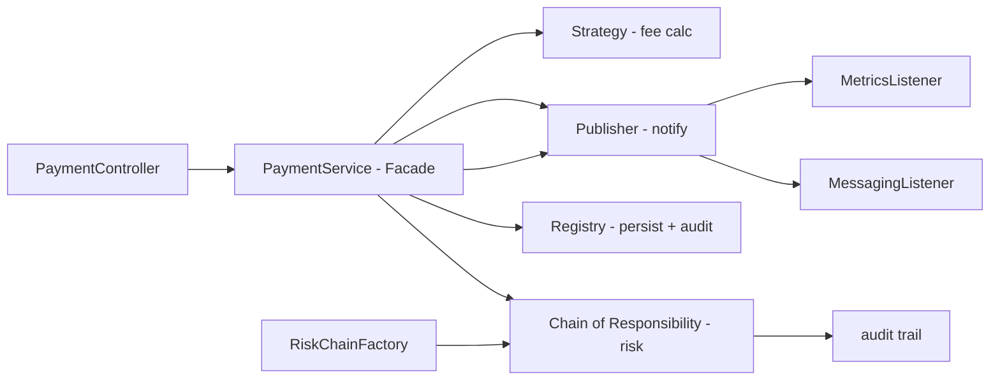

# kodapay-api

**English** · [Português (Brasil)](README.md)

[](https://adoptium.net/) [](https://spring.io/projects/spring-boot) [](https://maven.apache.org/) [](https://junit.org/junit5/) [](#.github/workflows/ci.yml) [](LICENSE)

## What it is

A REST payment API that demonstrates **6 GoF design patterns** in practice: Strategy, Chain of Responsibility, Factory, Facade, Observer and Registry (Singleton). Built with Spring Boot 3 and Java 21. The focus is showing the patterns applied to a real domain — processing a payment — with risk validation and an audit trail.

## Status

A working, tested API (26 tests, see the Tests section). It can be seen as a didactic demonstration of the patterns over a payment domain, not a complete production product.

## Features

- **Payment processing** in a single pipeline: validation → fee → risk → persistence → notification.
- **Per-method fee calculation** (Strategy): PIX flat R$ 0.49; Boleto flat R$ 2.49; Credit card 3.99% of the amount; Debit card 1.89% of the amount.
- **Risk validation** (Chain of Responsibility): HighValue → Blocklist → Velocity, with a veto that halts the flow above R$ 15,000.00 and for a payer on the restricted list.
- **Observability** (Observer): decoupled messaging and metrics listeners, with a snapshot on a dedicated endpoint.
- **Audit endpoint**: every chain handler records timestamped events.
- **OpenAPI documentation**: springdoc-openapi, Swagger UI and OpenAPI 3 spec.

## Architecture

Separated layers (web → service → chain/strategy/observer → domain) with `PaymentService` acting as the **Facade** that coordinates everything. Each pattern lives in its own package: `strategy`, `chain`, `observer`, `domain`.



## Stack

- Java 21, Spring Boot 3.5.16
- Spring Web, Spring Validation
- Springdoc OpenAPI 2.8.17
- Maven 3.9, spring-boot-starter-test (JUnit 5, Mockito, MockMvc)
- CI: GitHub Actions (`ci.yml`, `mvn -B verify` on Temurin JDK 21)

## Repository layout

```
kodapay-api/
├── pom.xml
├── mvnw
└── src/
    ├── main/java/com/kodapay/
    │   ├── chain/       # Chain strategies: Handlers + Chain + Factory + Registry
    │   ├── domain/       # Payment, PaymentMethod, PaymentStatus, AuditEvent
    │   ├── dto/          # PaymentRequest, PaymentResponse, PaymentView
    │   ├── exception/    # InvalidPayment, NotFound, RiskViolation
    │   ├── observer/     # Publisher + MessagingListener + MetricsListener
    │   ├── service/      # PaymentService (Facade)
    │   └── web/          # PaymentController, ObservabilityController
    └── test/java/com/kodapay/  # 4 test classes
```

## Prerequisites and installation

- JDK 21
- Maven 3.9+ (or use the `./mvnw` wrapper; the repository uses `only-script`, which downloads Maven automatically)

```bash
git clone https://github.com/KelvinOliveiraCode/kodapay-api.git
cd kodapay-api
```

## How to run

```bash
./mvnw spring-boot:run
# API at http://localhost:8080
# Swagger UI at http://localhost:8080/docs
# OpenAPI 3 at http://localhost:8080/api-docs
```

### Endpoints

| Method | Route | Description |
|--------|-------|-------------|
| POST | `/api/v1/payments` | Processes a payment (fee + risk + audit) |
| GET | `/api/v1/payments/{id}` | Finds a payment by id (404 if missing) |
| GET | `/api/v1/payments` | Lists the transaction history |
| GET | `/api/v1/observability` | Snapshot of the observers' effects |

Example request:

```bash
curl -X POST http://localhost:8080/api/v1/payments \
  -H "Content-Type: application/json" \
  -d '{"payerName":"Maria Silva","description":"Plano anual","amount":1200.00,"method":"CREDIT_CARD"}'
```

### Data model (PaymentRequest)

- `payerName` — string, 2–80 chars, required
- `description` — string, 2–120 chars, required
- `amount` — decimal ≥ 0.01, required
- `method` — `CREDIT_CARD`, `DEBIT_CARD`, `PIX` or `BOLETO`

Errors are returned as [RFC 7807 ProblemDetail](https://datatracker.ietf.org/doc/html/rfc7807) by the `GlobalExceptionHandler`.

## Tests and quality

Real command (verified by the agent, Maven 3.9.16 / JDK 21):

```bash
mvn -B test
# or
./mvnw verify
```

Result: `Tests run: 26, Failures: 0, Errors: 0, Skipped: 0` and `BUILD SUCCESS`.

- RiskChainTest: 5 tests
- PaymentServiceTest: 6 tests
- FeeCalculatorTest: 7 tests
- PaymentControllerTest: 8 tests (MockMvc, integration)

CI runs `mvn -B verify` on push/PR to `main`.

## Technical decisions and trade-offs

- **6 GoF patterns applied to a real domain** — the goal is didactic: each pattern shows up where it solves a concrete problem in the payment flow.
- **Factory creates a fresh chain per request**: a shared chain would keep its internal pointer at the end after the first call and skip later risk checks.
- **BigDecimal instead of double**: exact decimal arithmetic for cents, with `HALF_EVEN` rounding (avoids floating-point errors).
- **In-memory Singleton Registry behind an interface**: you can swap it for JPA/Hibernate without touching `PaymentService`.
- **No authentication**: out of scope for the demonstration; production would need auth.

## Known limitations and roadmap

- In-memory persistence (data is lost on restart).
- No authentication/authorization.
- Messaging is simulated (in-memory listener); there is no external broker.

## Development process

An individual project by Kelvin Oliveira, built with orchestrated AI agents and reviewed by the author. The GoF pattern architecture and the review are the author's.

## License and author

MIT — Copyright (c) 2026 Kelvin Rebelo de Oliveira.

**Author**: [Kelvin Oliveira](https://github.com/KelvinOliveiraCode) · [Portfolio](https://kelvinoliveiracode.github.io/portfolio/)
