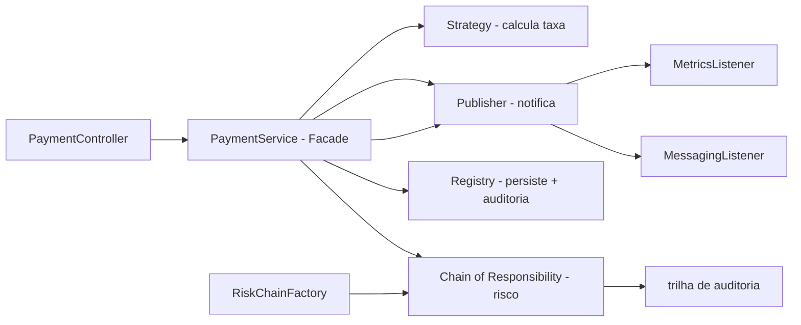

# kodapay-api

[English](README.en.md) · **Português (Brasil)**

[](https://adoptium.net/) [](https://spring.io/projects/spring-boot) [](https://maven.apache.org/) [](https://junit.org/junit5/) [](#.github/workflows/ci.yml) [](LICENSE)

## O que é

API REST de pagamentos que demonstra **6 padrões de projeto GoF** na prática: Strategy, Chain of Responsibility, Factory, Facade, Observer e Registry (Singleton). Construída com Spring Boot 3 e Java 21. O foco é mostrar os padrões aplicados a um domínio real — processar um pagamento — com validação de risco e trilha de auditoria.

## Status

API funcional e testada (26 testes, ver seção Testes). Pode ser considerada uma demonstração didática dos padrões sobre um domínio de pagamentos, não um produto completo para produção.

## Funcionalidades

- **Processamento de pagamento** em um pipeline: validação → taxa → risco → persistência → notificação.
- **Cálculo de taxa por meio de pagamento** (Strategy): PIX taxa fixa R$ 0,49; Boleto taxa fixa R$ 2,49; Crédito 3,99% sobre o valor; Débito 1,89% sobre o valor.
- **Validação de risco** (Chain of Responsibility): HighValue → Blocklist → Velocity, com veto que interrompe o fluxo acima de R$ 15.000,00 e para pagador na lista restrita.
- **Observabilidade** (Observer): listeners de mensageria e métricas desacoplados, com snapshot em endpoint próprio.
- **Endpoint de auditoria**: cada handler da cadeia grava eventos com carimbo de data/hora.
- **Documentação OpenAPI**: springdoc-openapi, Swagger UI e spec OpenAPI 3.

## Arquitetura

Camadas separadas (web → service → chain/strategy/observer → domain) com o `PaymentService` como **Facade** que coordena tudo. Cada padrão vive no seu pacote: `strategy`, `chain`, `observer`, `domain`.



## Stack

- Java 21, Spring Boot 3.5.16
- Spring Web, Spring Validation
- Springdoc OpenAPI 2.8.17
- Maven 3.9, spring-boot-starter-test (JUnit 5, Mockito, MockMvc)
- CI: GitHub Actions (`ci.yml`, `mvn -B verify` na JDK 21 Temurin)

## Estrutura do repositório

```
kodapay-api/
├── pom.xml
├── mvnw
└── src/
    ├── main/java/com/kodapay/
    │   ├── chain/       # Strategy da cadeia: Handlers + Chain + Factory + Registry
    │   ├── domain/       # Payment, PaymentMethod, PaymentStatus, AuditEvent
    │   ├── dto/          # PaymentRequest, PaymentResponse, PaymentView
    │   ├── exception/    # InvalidPayment, NotFound, RiskViolation
    │   ├── observer/     # Publisher + MessagingListener + MetricsListener
    │   ├── service/      # PaymentService (Facade)
    │   └── web/          # PaymentController, ObservabilityController
    └── test/java/com/kodapay/  # 4 classes de teste
```

## Pré-requisitos e instalação

- JDK 21
- Maven 3.9+ (ou use o wrapper `./mvnw`; o repositório usa `only-script`, que baixa o Maven automaticamente)

```bash
git clone https://github.com/KelvinOliveiraCode/kodapay-api.git
cd kodapay-api
```

## Como executar

```bash
./mvnw spring-boot:run
# API em http://localhost:8080
# Swagger UI em http://localhost:8080/docs
# OpenAPI 3 em http://localhost:8080/api-docs
```

### Endpoints

| Método | Rota | Descrição |
|--------|------|-----------|
| POST | `/api/v1/payments` | Processa um pagamento (taxa + risco + auditoria) |
| GET | `/api/v1/payments/{id}` | Busca um pagamento por id (404 se não existir) |
| GET | `/api/v1/payments` | Lista o histórico de transações |
| GET | `/api/v1/observability` | Snapshot dos efeitos dos observadores |

Exemplo de requisição:

```bash
curl -X POST http://localhost:8080/api/v1/payments \
  -H "Content-Type: application/json" \
  -d '{"payerName":"Maria Silva","description":"Plano anual","amount":1200.00,"method":"CREDIT_CARD"}'
```

### Modelo de dados (PaymentRequest)

- `payerName` — string, 2–80 caracteres, obrigatório
- `description` — string, 2–120 caracteres, obrigatório
- `amount` — decimal ≥ 0.01, obrigatório
- `method` — `CREDIT_CARD`, `DEBIT_CARD`, `PIX` ou `BOLETO`

Erros são retornados como [RFC 7807 ProblemDetail](https://datatracker.ietf.org/doc/html/rfc7807) pelo `GlobalExceptionHandler`.

## Testes e qualidade

Comando real (verificado pelo agente, Maven 3.9.16 / JDK 21):

```bash
mvn -B test
# ou
./mvnw verify
```

Resultado: `Tests run: 26, Failures: 0, Errors: 0, Skipped: 0` e `BUILD SUCCESS`.

- RiskChainTest: 5 testes
- PaymentServiceTest: 6 testes
- FeeCalculatorTest: 7 testes
- PaymentControllerTest: 8 testes (MockMvc, integração)

CI roda `mvn -B verify` no push/PR para `main`.

## Decisões técnicas e trade-offs

- **6 padrões GoF aplicados a um domínio real** — o objetivo é didático: cada padrão aparece onde resolve um problema concreto do fluxo de pagamento.
- **Factory cria uma cadeia nova por requisição**: uma cadeia única compartilharia o ponteiro interno e pularia checagens após a primeira chamada.
- **BigDecimal em vez de double**: aritmética decimal exata para centavos, com arredondamento `HALF_EVEN` (evita erros de ponto flutuante).
- **Registry em memória (Singleton) atrás de interface**: dá pra trocar por JPA/Hibernate sem tocar no `PaymentService`.
- **Sem autenticação**: fora do escopo da demonstração; produção precisaria de auth.

## Limitações conhecidas e roadmap

- Persistência em memória (perde dados ao reiniciar).
- Sem autenticação/autorização.
- Mensageria é simulada (listener em memória), não há broker externo.

## Processo de desenvolvimento

Projeto individual de Kelvin Oliveira, construído com agentes de IA orquestrados e revisado pelo autor. A arquitetura de padrões GoF e a revisão são do autor.

## Licença e autor

MIT — Copyright (c) 2026 Kelvin Rebelo de Oliveira.

**Autor**: [Kelvin Oliveira](https://github.com/KelvinOliveiraCode) · [Portfólio](https://kelvinoliveiracode.github.io/portfolio/)
